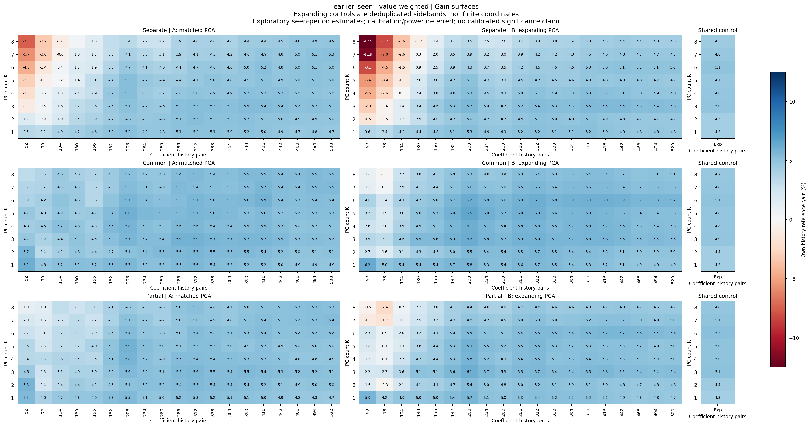
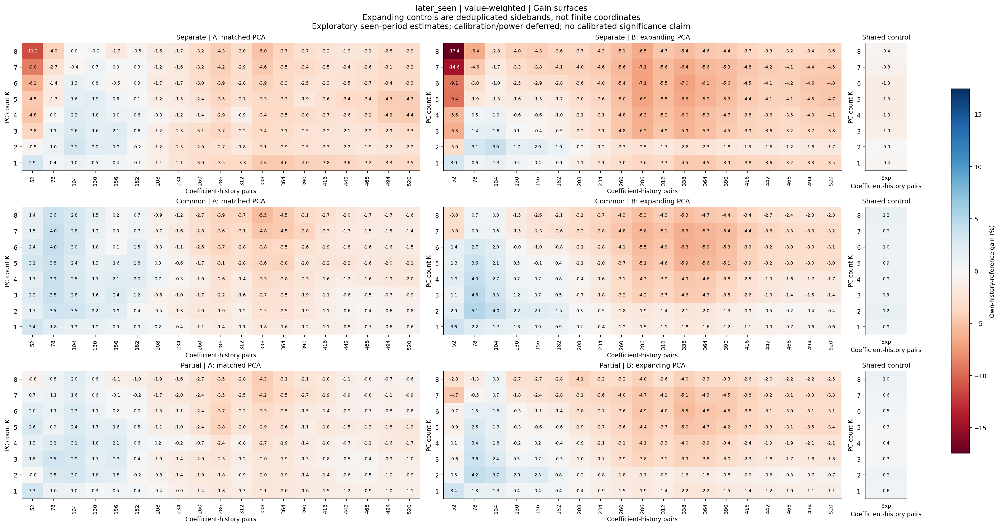

## Project proposal and purpose

A larger panel can help forecast an industry's risk in two different ways: other industries provide measurements of common conditions, and their outcomes help estimate how those conditions predict future risk. These roles require different similarities. An industry can measure the common state well while having a predictive response unlike the target's. We ask **when choosing measurement donors and coefficient-sharing donors separately improves forecasts**, particularly with short target histories.

Both equations use the same weekly log variance proxy $v_{jt}=\log(\sum_{d\in t}r_{jd}^2+10^{-8})$, where $r_{jd}$ is the return for industry $j$ on day $d$.

$$
v_{jt}=\mu_j+\ell_j^{\top}f_t+u_{jt},\quad j\in M,\qquad
v_{i,t+1}=a_i+b_i^{\top}z_{it}+\theta_i^{\top}f_t+\varepsilon_{i,t+1}.
$$

The latent factors $f_t$ enter the measurement equation linearly. We fit scaling and PCA on training weeks and apply them to the week-$t$ panel to obtain scores $\hat f_t$. The controls $z_{it}$ contain $v_{it}$ and its trailing four- and twelve-week averages through week $t$.

We assume finite second moments. The measurement error $u_{jt}$ has mean zero and is uncorrelated with $f_t$. The unrestricted best linear predictor under squared loss has a mean-zero population error $\varepsilon_{i,t+1}$ orthogonal to $z_{it}$ and $f_t$. These conditions permit dependent, non-Gaussian errors with varying variance.

Outcome donors $O$ help estimate the target's factor slopes $\theta_i$. Own-history coefficients remain industry-specific. We compare separate, partially pooled, and common factor slopes. We hypothesize that broad, informative measurement and selective coefficient sharing can complement each other when measurement quality and slope similarity differ. Correlated noise, heterogeneity, and instability can offset the gains.

At fixed factor count K, expanding M does not itself add target regression coefficients. The relevant tradeoffs must therefore come from measurement quality, sharing bias, instability, or fitted dimension. A supporting question is which components predict the target: the dominant variance directions need not be the useful predictive directions. Factors restrict a direct regression's coefficient space; any benefit is finite-sample regularization rather than an information advantage over unrestricted population prediction. Ridge, elastic net, and supervised dimension reduction are essential comparisons.

The intended contribution is an interpretable rule for assigning donor roles and predictive dimension, evaluated chronologically and then supported by mechanism simulations and appropriately scoped theory. Industry volatility offers shared conditions with heterogeneous transmission. Moreira and Muir [7] motivate volatility-based exposure scaling. We would assess a feasible single-asset or fixed-portfolio decision rule after turnover/costs; no economic-utility evaluation has been performed.

## Related research and positioning

**Factor measurement and targeting.** Stock and Watson [1] establish conditions under which PCA-based forecasts approach forecasts using observed factors as panel and history grow. Boivin and Ng [2] show that adding series can worsen factor forecasts when idiosyncratic errors are correlated or predictive factors become obscured. Bai and Ng [3] select predictors for the target before extracting components, demonstrating why variance-based compression alone can miss predictive information. These studies motivate careful measurement-panel composition and forecast-oriented dimension choice.

<!-- progress-page-break -->

**Pooling and selective transfer.** Pesaran, Pick, and Timmermann [4] formalize the forecasting tradeoff between parameter heterogeneity and estimation uncertainty. Teller, Pigorsch, and Pigorsch [5] transfer selected source-series subsequences to volatility forecasting for new issues and spin-offs with limited histories. Fu and Jiang [6] develop factor-augmented sparse transfer regression with data-driven identification of informative auxiliary datasets. Our proposed emphasis is the joint assignment of synchronized industries to measurement and coefficient-sharing roles under dependent-data forecasting. Pooling and selective transfer are established ideas; a distinct contribution from this role separation remains to be demonstrated.

**Data perturbation.** Zhang and Shen [8] perturb fixed-design regression responses to assess model-selection uncertainty. This motivates checking the stability of donor and component choices with perturbations that respect the weekly panel's dependence.

## Common empirical setup

We archived French 48-industry daily returns, both portfolio weightings, provenance, and hashes. Each weekly proxy requires at least three observed daily returns. We compare forecasts based on own history, cross-industry factors, and direct predictors. Targets are Food, Mach, Banks, Oil, Util, and Hlth. Transformations and tuning use historical data only. Reported gains average target-specific percentage MSE reductions against the stated reference. Positive gains favor the factor procedure. Value-weighted portfolios are primary, with equal-weighted robustness.

## Experiment 1: measurement breadth and coefficient sharing

**Purpose and procedure.** Test whether a broader measurement panel and outcome sharing improve forecasts. Eighteen fixed procedures compared six versus 48 measurement industries, target/six/all-48 outcome panels, separate/common/partial slopes, two PCA components, and direct/own-history baselines. Selection used 2005-2021 forecasts and was frozen before 156 evaluation dates in 2022-2024.

**Results.** The selected all-48 measurement/common-slope procedure reduced MSE relative to own regression by **4.27%** (value weighted) and **1.66%** (equal weighted). With separate target slopes, expanding measurement from six to 48 raised gains from 1.79% to 4.12%; common slopes then added only 0.15 percentage points. Broader measurement supplied most of this pilot's benefit. Narrowing outcome donors to the fixed six did not help overall; equal-weighted Banks worsened 2.95%, and equal-weighted ridge outperformed the selected factor procedure. This experiment supplied descriptive results, without uncertainty estimates or a learned donor selector.

## Experiment 2: uncertainty and coefficient-history length

**Purpose and procedure.** Quantify uncertainty and test whether shorter coefficient histories help the fixed two-factor/all-48/common-slope procedure. PCA remained expanding; coefficient windows were 104/260/520/expanding pairs. Paired stationary bootstraps used 9,999 draws, primary expected block length 13, and Holm adjustment against own regression and direct methods, plus finite-versus-expanding factor comparisons.

**Results.** Reanalysis of already-seen 2022-2024 losses gave the 4.27% own-history gain a nominal 95% interval [1.71%, 6.92%] and adjusted p=0.0028; direct-reference comparisons did not pass. On 87 retrospectively evaluated dates in 2025-August 2026, with previously uninspected forecast losses, no history established an advantage over own history or ridge. L=104 beat elastic net and PLS under the approximate rule (8.57% and 13.74%; adjusted p=0.0019 each), but no finite history beat expanding coefficients. Calibration was unresolved: a 100-replication diagnostic rejected a nominal 5% null 11 times at 87 dates; nominal 95% coverage was 90/100 there and 81/100 at 156 dates. Holm cannot repair marginal miscalibration.

<!-- progress-page-break -->

## Experiment 3: dimension, history, pooling, and PCA history

**Purpose and procedure.** Examine whether pooling's benefit depends on model size and history, and distinguish PCA history from coefficient history. We crossed K=1-8 with 19 windows L=52,78,...,520 plus expanding controls, under separate/common/partial slopes. Part A matched PCA/scaler and coefficient windows; Part B used expanding PCA with the same coefficient windows. Measurement and pooled outcomes used all 48 industries. Both evaluation periods were now already inspected.

**Results.** Figures 1-2 show strong period dependence. Later value-weighted matched-PCA K=2/common gains were **3.53%, -2.00%, -0.75%** at L=104/260/520; earlier gains persisted with long histories. At L=52, increasing K from 1 to 8 changed gains from +2.93% to -11.24% with separate slopes, versus +3.40% to +1.37% with common slopes and +3.29% to -0.75% with partial pooling. Pooling cushioned dimension costs; partial pooling and expanding PCA were not uniformly superior. None of 30 prespecified comparisons passed the primary block-13 Holm rule in either weighting; the 3.53% example's nominal 95% marginal interval was [-3.18%, 12.18%]. Saved-loss bootstraps did not refit models. Relative gains use a changing own-history benchmark and therefore do not rank absolute accuracy or establish a universal short-history advantage.

## Experiment 4: panel compression and ridge

**Procedure and results.** We crossed full-panel and two-PC predictors with OLS and ridge at matched histories and added penalized own-history fits. Two-PC OLS and full-panel ridge each beat full-panel OLS in all 20 settings across periods, weightings and histories. Two-PC ridge beat full-panel ridge in **16 of 20**. Gains over own history varied by period and history. These comparisons use previously inspected periods.

## Planned next steps

**Experiment 5 on calibration and power is proposed and awaits authorization.** It will compare inference methods using simulated losses with known gains, then repeat factor estimation and tuning on simulated weekly panels. We also propose controlled measurement-noise and slope-heterogeneity experiments and evaluation on an uninspected period or market. Learned donor selection, theory, and economic utility remain prospective contributions.

Detailed procedures, results, and audits: [Experiment 1](../experiments/01-fixed-s6-pilot/README.md), [Experiment 2](../experiments/02-bootstrap-history/README.md), [Experiment 3](../experiments/03-pca-history-surface/README.md), and [Experiment 4](../experiments/04-panel-vs-pc-regularization/README.md). See the [Experiment 5 plan](../experiments/05-calibration-power/protocol.md) and the [original proposal](archive/2026-10-09/proposal.pdf).

## Selected references

1. Stock and Watson (2002), [*Forecasting Using Principal Components from a Large Number of Predictors*](https://doi.org/10.1198/016214502388618960).
2. Boivin and Ng (2006), [*Are More Data Always Better for Factor Analysis?*](https://doi.org/10.1016/j.jeconom.2005.01.027).
3. Bai and Ng (2008), [*Forecasting Economic Time Series Using Targeted Predictors*](https://doi.org/10.1016/j.jeconom.2008.08.010).
4. Pesaran, Pick, and Timmermann (2026), [*Forecasting with Panel Data: Estimation Uncertainty versus Parameter Heterogeneity*](https://doi.org/10.3982/QE2589).
5. Teller, Pigorsch, and Pigorsch (2026), [*Realized Volatility Forecasting for New Issues and Spin-Offs Using Multi-Source Transfer Learning*](https://doi.org/10.1016/j.ijforecast.2026.02.004).
6. Fu and Jiang (2025; revised 2026), [*Transfer Learning for High-Dimensional Factor-Augmented Sparse Linear Model*](https://arxiv.org/abs/2511.12435v3), preprint.
7. Moreira and Muir (2017), [*Volatility-Managed Portfolios*](https://doi.org/10.1111/jofi.12513).
8. Zhang and Shen (2015), [*Adaptive Modeling Procedure Selection by Data Perturbation*](https://doi.org/10.1080/07350015.2014.965307).

<!-- progress-landscape-begin -->

## Figure 1: earlier-period forecasting gains

**2011-2024, 718 forecast dates; exploratory, previously inspected.** Horizontal axes show coefficient-history pairs L; vertical axes show factors K. Rows compare separate/common/partial slopes; columns compare matched/expanding PCA. Blue indicates lower MSE than matching-history own regression, averaged equally across six targets. Expanding-coefficient controls appear separately at right. Longer histories retain broadly favorable gains; sharing cushions high-K/short-history deterioration. Colors show point estimates, not significance.

<!-- progress-landscape-next -->

## Figure 2: later-period forecasting gains

**2025-August 2026, 87 forecast dates; exploratory, previously inspected.** Axes, rules, and reference definitions match Figure 1. Short windows often show a larger relative edge, while additional factors particularly hurt separate slopes. Partial pooling and expanding PCA are not uniformly superior. The changing own-history benchmark means these maps do not rank absolute accuracy. Color limits differ across periods: compare cell values, not shades. No primary Holm-adjusted anchor rejects.

<!-- progress-landscape-end -->
