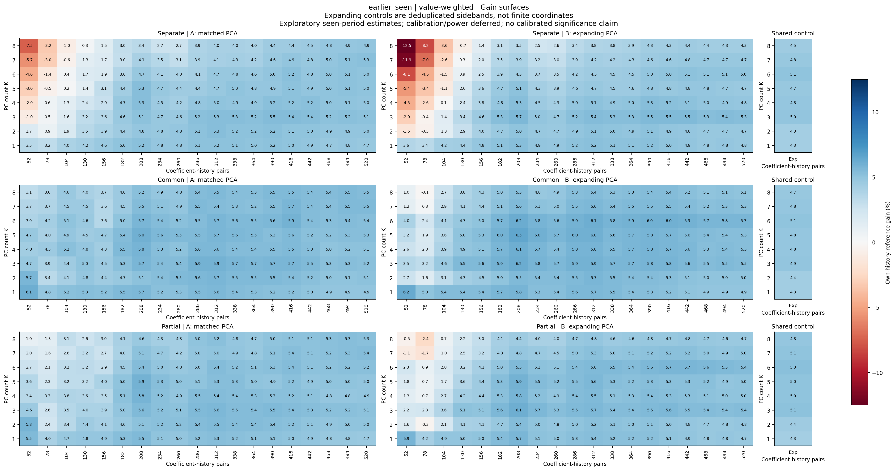
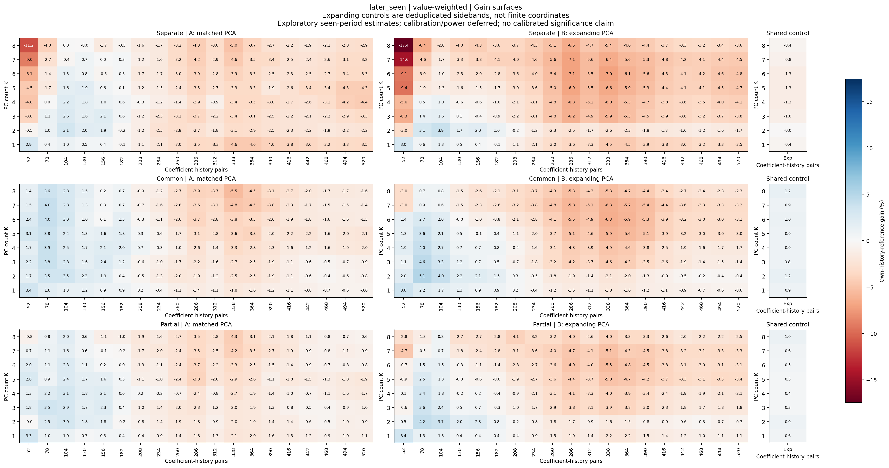

## Research question and initial plan

Industries can measure common conditions ($M$) or help estimate predictive coefficients ($O$). We ask when assigning these roles separately improves risk forecasts. We hypothesize measurement expansion helps at fixed dimension, and sharing helps with short histories and similar slopes; heterogeneity, noise, or instability can offset gains. Motivated by principal-component forecasting [1] and panel-composition evidence [2], we study finite-sample variance/information tradeoffs. Dimension reduction cannot improve the unrestricted population optimum with identical information.

## Completed foundation and first two experiments

We archived French 48-industry daily returns, both weightings, provenance, missingness, and hashes. Weekly $Q_{jt}=\sum_d r_{jd}^2$ and $v_{jt}=\log(Q_{jt}+10^{-8})$ require at least three daily returns. These proxy daily-return variation. Own controls are current $v$ and complete trailing four-/twelve-week means; the response is next calendar week's $v$.

Experiment 1 fixed Food, Mach, Banks, Oil, Util, and Hlth as targets and the small donor panel. Eighteen procedures compared panels, sharing, direct methods, and baselines. Selection preceded 2022-2024 evaluation. The selected all-48/common-slope factor gained **4.27%** against own history; equal-weighted gain was **1.66%**, including **2.95% worse Banks MSE**. Broader measurement supplied most of the gain.

Experiment 2 added paired stationary bootstraps [3] and coefficient histories 104/260/520/expanding, with expanding PCA. In 2025-August 2026, no history beat own history or ridge after Holm-19 adjustment. L=104 beat elastic net and PLS under the approximate rule. No finite history showed an adjusted advantage over expanding coefficients.

## Experiment 3: completed November 3

We mapped **K=1-8 factors** against **L=52,78,...,520 coefficient pairs**, plus expanding controls, for separate/common/partial slopes. Part A fitted PCA/scalers and coefficients on the same recent L rows; Part B used expanding PCA with identical coefficient windows. Measurement and common/partial outcome sharing used all 48 industries. Own coefficients stayed industry-specific; partial-pooling penalties used historical target validation.

All configurations shared 718 earlier dates (2011-2024) and 87 later dates (2025-August 2026), both already inspected. Results are exploratory; forecast windows, tuning, losses, and inference were independently audited.

For value-weighted portfolios, the table fixes K=2/common slopes. Gains average six targets' percentage MSE reductions against their matching-history own regressions.

| Coefficient pairs | Earlier: matched PCA | Later: matched PCA | Later: expanding PCA |
| --- | ---: | ---: | ---: |
| 52 | 5.73% | 1.66% | 1.96% |
| 104 | 4.15% | 3.53% | 3.97% |
| 260 | 5.47% | -2.00% | -1.75% |
| 520 | 5.08% | -0.75% | -0.41% |

**History effects depend on period and weighting.** Later value gains favored roughly 78-104 pairs over 260-520, without falling monotonically. Earlier gains persisted with long histories. Later equal-weighted K=2/common gained 0.92% at matched L=104 and 3.01% with expanding coefficients/PCA. A universal short-history advantage is unsupported.

**Relative edge differs from absolute accuracy.** Later value-weighted K=2/common MSE was 0.7516 at matched L=104, versus 0.7181 with expanding coefficients/PCA, although gains were 3.53% versus 1.23%. The longer-history own-regression benchmark was also stronger.

**Pooling cushioned extra-factor costs.** At L=52, later value/matched-PCA gains changed from K=1 to K=8: separate +2.93% to -11.24%, common +3.40% to +1.37%, partial +3.29% to -0.75%. Longer history helped separate slopes catch up earlier. This is consistent with lower estimation variance from sharing. Partial pooling did not reliably improve on common slopes.

**Longer PCA history was not uniformly beneficial.** Expanding PCA helped the K=2 value anchors, but reduced gains by a median 1.2-1.6 percentage points across finite histories in the later value grid. It changed scaling/loadings, downstream fits, and partial-pooling penalty choices. Neither this contrast nor the pooling pattern identifies a causal mechanism. All unfavorable configurations remain reported.

Bootstraps used 9,999 draws of saved losses, without refitting/retuning. **None of 30 later-period anchors passed primary block-13 Holm adjustment in either weighting.** Later value/matched K=2/common/L=104 gained 3.53%, with nominal 95% marginal interval [-3.18%, 12.18%]. Two equal-weighted block-26 sensitivity flags did not replace the primary result.

## Inference limits and pending work

**Bootstrap calibration remains unresolved.** The inherited 100-replication diagnostic rejected a nominal 5% null 11% of the time at 87 dates; nominal 95% coverage was 90% at 87 dates and 81% at 156. Holm cannot repair marginal miscalibration. Audits verify computations, not coverage. Dependence, nested models, fixed targets, source revisions, and short evaluation histories constrain claims; non-rejection does not establish equivalence.

## Next steps and questions for discussion

Before another empirical grid, we propose agreeing on a narrow hypothesis and confirmation design: does pooling help most when coefficient history is short relative to model dimension? Experiment 3 fixed all 48 measurement industries; choosing different measurement and coefficient-sharing donor sets remains open.

Calibration and power studies remain **deferred and pending**; their design is a priority for discussion. We propose comparing false-rejection rates, coverage, and power under controlled dependence and known forecast advantages, including repeated fitting/tuning. Measurement-noise/slope-heterogeneity experiments and learned donor selection remain later work. Empirical confirmation requires an uninspected period or market.

Protocols, complete results, graphs, and audits: [Experiment 1](../experiments/01-fixed-s6-pilot/README.md), [Experiment 2](../experiments/02-bootstrap-history/README.md), [Experiment 3](../experiments/03-pca-history-surface/README.md). The original proposal remains archived.

## Selected references

1. Stock and Watson (2002), *Forecasting Using Principal Components from a Large Number of Predictors*. [DOI](https://doi.org/10.1198/016214502388618960).
2. Boivin and Ng (2006), *Are More Data Always Better for Factor Analysis?* [DOI](https://doi.org/10.1016/j.jeconom.2005.01.027).
3. Politis and Romano (1994), *The Stationary Bootstrap*. [DOI](https://doi.org/10.1080/01621459.1994.10476870).

<!-- progress-landscape-begin -->

## Figure 1: earlier-period forecasting gains

**2011-2024, 718 forecast dates; exploratory, previously inspected.** Horizontal axes show coefficient-history pairs L; vertical axes show factors K. Rows compare separate/common/partial slopes; columns compare matched/expanding PCA. Blue indicates lower MSE than matching-history own regression, averaged equally across six targets. Expanding-coefficient controls appear separately at right. Longer histories retain broadly favorable gains; sharing cushions high-K/short-history deterioration. Colors show point estimates, not significance.

<!-- progress-landscape-next -->

## Figure 2: later-period forecasting gains

**2025-August 2026, 87 forecast dates; exploratory, previously inspected.** Axes, rules, and reference definitions match Figure 1. Short windows often show a larger relative edge, while additional factors particularly hurt separate slopes. Partial pooling and expanding PCA are not uniformly superior. The changing own-history benchmark means these maps do not rank absolute accuracy. Color limits differ across periods: compare cell values, not shades. No primary Holm-adjusted anchor rejects.

<!-- progress-landscape-end -->
